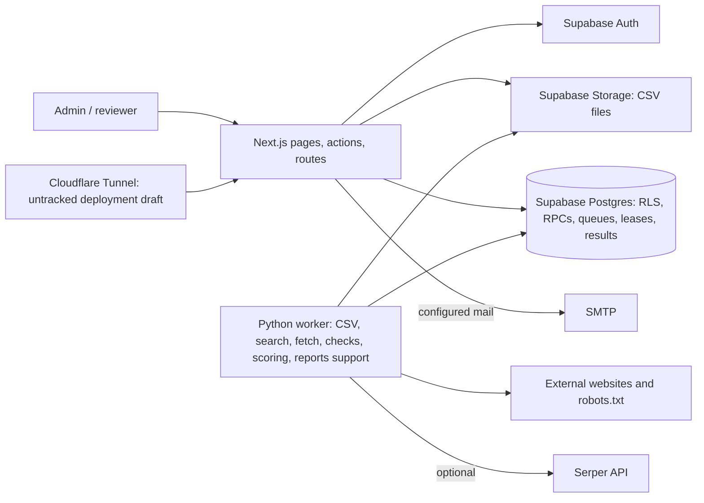

# Repository orientation audit

## Executive summary
1. Current product: a human-reviewed backlink **prospect** pipeline, with optional paid search, focused crawl and placed-link verification; it does not place links (`README.md:3-13`, `apps/worker/src/worker/main.py:50-96`).
2. Architecture: Next.js talks to Supabase Auth, Storage and Postgres; a Python worker uses direct Postgres and outbound HTTP (`README.md:15-20`, `apps/worker/src/worker/main.py:45-96`).
3. Severity count: **BLOCKER 0, HIGH 3, MEDIUM 9, LOW 1** (13 deduplicated findings below).
4. Broken now: checked-in local worker examples connect as Postgres superuser, bypassing the worker privilege model (O-01).
5. Broken now: `make check` runs database integration tests although `docs/testing.md` calls it data-free and service-free (O-02).
6. Product contract drift: a 2026-11-04 migration permits Ready-row displacement despite ADR 0023's permanent-membership promise (O-03).
7. Documentation drift: several milestone files describe the check handler, search, Reports, crawl and link verification as future work even though they are wired (O-05, O-06).
8. Migration history: **69 tracked migrations; 19 identifiable corrective or behavior-revision follow-ons** under the explicit counting rule below (O-04).
9. Hygiene: no tracked build/cache directory or duplicate lockfile found; two tracked, duplicate ad-hoc Admin-promotion SQL snippets contain a real email (O-08).
10. Production behavior, historical test pass counts, provider billing and pilot quality remain **UNVERIFIED** from a read-only source audit (O-10).

**Method.** Read `AGENTS.md`, both root guides, the app READMEs, all 26 files in `docs/adr/`, all other existing `docs/*.md`, both `docs/runbooks/*.md`, and the untracked `deploy/production/README.md`. Compared claims with current source, migrations, tests, `git ls-files`, `.gitignore`, and working-tree status. “Verified” means implementation or a focused test exists in this checkout; it does **not** mean a live deployment or historical test result was reproduced. Related field-by-field assertions are grouped into one row when they share the same implementation boundary. Historical plans and QA observations are evaluated as dated claims, not current guarantees. No application code or database was changed.

## What the product actually does today

An authenticated user creates a job for one client site, configures activities and search inputs, and can upload competitor and client backlink CSVs. The browser maps columns and confirms usable uploads. The worker imports the competitor-minus-client domain gap and seed URLs; optional Serper searches add candidates. It normalizes and deduplicates URLs, checks candidate pages under SSRF, robots, rate and size limits, records raw evidence, filters explicit failures, scores other candidates and assigns review queues. People claim, approve, reject, reopen or mark results Used; reports and CSV exports summarize those decisions. A manual placement record can be verified by a separate worker, but that verifier and the focused crawl are disabled by default (`apps/worker/src/worker/config/settings.py:17-44`, `apps/worker/src/worker/main.py:50-96`, `apps/web/src/features/results/actions.ts:145-190`). “Used” or “Approved” alone is not a verified link (`supabase/migrations/20261104050000_link_placements.sql:4-34`). The repository has no automatic outreach or link-placement path in the app/worker entry points reviewed; a full deployed-service inventory is UNVERIFIED.

## Architecture: documented and actual

The short ADR picture is “one Next.js app + one worker process type + one Postgres” (`docs/adr/0001-modular-monolith.md:1-7`), with Postgres leases (`docs/adr/0002-postgres-queue.md:1-7`), direct worker SQL (`docs/adr/0003-direct-pg-worker.md:1-7`), and local hosting deferred (`docs/adr/0011-local-first-hosting.md:1-5`). The current implementation has more service boundaries:

The worker uses `psycopg_pool` and SQL directly (`apps/worker/src/worker/db/pool.py:4-14`, `apps/worker/src/worker/main.py:45-55`); browser and server-side web code use Supabase clients and RLS (`apps/web/src/lib/supabase/server.ts:1-26`, `apps/web/src/lib/auth/session.ts:25-61`). The actual worker starts separate loops for opportunity checks, CSV ingestion, rescoring and Storage cleanup, plus conditional job pickup, search and link verification (`apps/worker/src/worker/main.py:50-96`). The hosting diagram edge is a **working-tree draft**, not tracked deployment evidence (`git status --short` shows `?? deploy/`). ADRs 0002 and 0003 are compatible; a Postgres queue can be consumed by a direct-SQL worker. The tension with 0011 is the unrecorded move toward a hosted stack, not a queue-vs-connection contradiction.

## Concrete claim ledger

`Yes` = code/migration evidence; `Partial` = narrower or conditional than written; `No` = contradicted; `UNVERIFIED` = needs runtime, external account or historical logs. Each row cites the claim location and the boundary checked. “Drift” points to a finding where material.

| Claim | Source doc | Verified? | Evidence | Drift? |
|---|---|---|---|---|
| Jobs, CSV gap, optional search, checks, human review and reports form the product | `README.md:3-13` | Yes | `apps/worker/src/worker/main.py:50-96`; `apps/web/src/app/(app)/jobs/[id]/page.tsx:58`; `apps/web/src/app/(app)/reports/page.tsx:21` | No |
| Web is Next.js; worker is Python; Supabase supplies database, Auth and Storage | `README.md:15-20` | Yes | `apps/web/package.json:17-30`; `apps/worker/pyproject.toml:1-20`; `apps/worker/src/worker/main.py:45-65` | No |
| Search off by default; Serper key enables it | `README.md:34`; `apps/worker/README.md:9` | Yes | `apps/worker/src/worker/config/settings.py:17-18`; `apps/worker/src/worker/main.py:29-30,80-96` | No |
| Worker claims jobs/CSV and handles checks, score and optional tasks | `apps/worker/README.md:3-9` | Yes | `apps/worker/src/worker/main.py:50-96` | No |
| Local web setup and command names | `apps/web/README.md:5-25`; `README.md:22-43` | Partial | `apps/web/package.json:5-15`; `Makefile:29-36` | O-11 |
| Production VPS/Cloudflare/Supabase configuration is available | `deploy/production/README.md:1-5,54-86` | Partial | `deploy/production/compose.yaml:1-64`; `git status --short` (`?? deploy/`) | O-07 |
| Conventional commits, one S-task/PR, config as data, Serper-only paid service | `CONTRIBUTING.md:1-3` | Partial | `.github/workflows/ci.yml:1-87`; `apps/worker/src/worker/scoring/defaults.json:1`; `apps/worker/src/worker/providers/serper.py:59` | Process enforcement and paid account inventory UNVERIFIED |
| ADR template has Proposed/Accepted/Superseded status and review trigger | `docs/adr/0000-template.md:1-8` | Partial | `docs/adr/0011-local-first-hosting.md:1-5`; `docs/adr/0023-stable-review-queues-and-bounded-release.md:1-3` | O-07 |
| Modular app/worker/Postgres architecture | `docs/adr/0001-modular-monolith.md:3` | Partial | `apps/worker/src/worker/main.py:45-96`; `apps/web/src/lib/supabase/server.ts:1-26` | Service boundaries omitted; O-07 |
| Queue uses Postgres `SKIP LOCKED` and leases | `docs/adr/0002-postgres-queue.md:3` | Yes | `supabase/migrations/20261013164139_m3_job_engine.sql:1-100`; `supabase/migrations/20261031010000_m8_budget_enforcement.sql:7-58` | No |
| Worker uses direct async Postgres pool | `docs/adr/0003-direct-pg-worker.md:3` | Yes | `apps/worker/src/worker/db/pool.py:4-14`; `apps/worker/src/worker/main.py:45` | O-01 for local credential example |
| Catalog-driven permissions with RLS | `docs/adr/0004-permission-catalog.md:3`; `docs/authorization.md:3-13` | Yes | `supabase/migrations/20261008075422_m1_guards_and_rls.sql:22-42,176-227` | No |
| Job config snapshots persist across edits | `docs/adr/0005-config-versioning.md:3`; `docs/data-dictionary.md:408-424` | Yes | `supabase/migrations/20261010182546_m2_job_lifecycle.sql:1-153`; `supabase/tests/database/050_job_state_machine.test.sql:1-20` | No |
| Opportunity has six durable pipeline states | `docs/adr/0006-opportunity-state-machine.md:3` | No | `supabase/migrations/20261013150133_m3_opportunities.sql:17-32,61-68`; `apps/worker/src/worker/stages/opportunity.py:148-193` | O-06 |
| Fetcher has socket-boundary SSRF guards, limits and tests | `docs/adr/0007-fetcher-ssrf-guards.md:3,9-30` | Yes (source/tests) | `apps/worker/src/worker/fetch/transport.py:20-54,96-115`; `apps/worker/tests/unit/test_fetch_transport.py:1` | Live hostile-network behavior UNVERIFIED |
| CSV parsing is worker-side | `docs/adr/0008-csv-in-worker.md:3` | Yes | `apps/worker/src/worker/engine/csv_runner.py:30,152-216` | No |
| Dashboard polls counters, no Realtime | `docs/adr/0009-polling-counters.md:3`; `docs/runbooks/worker.md:182-189` | Yes | `apps/web/src/features/jobs/stats.ts:3-16`; `apps/web/src/features/jobs/live-stats.tsx:34-75` | No |
| SearchProvider abstraction and Serper per-call credit validation | `docs/adr/0010-search-provider-interface.md:3,9-16` | Yes | `apps/worker/src/worker/providers/search.py:22-31`; `apps/worker/src/worker/providers/serper.py:26-28,59-115` | Live billing UNVERIFIED |
| Worker local for now; hosting later; logs/events only | `docs/adr/0011-local-first-hosting.md:1-5` | Partial | `deploy/production/README.md:1-5`; `apps/worker/src/worker/logging.py:1-16`; `git status --short` | O-07 |
| `roles.manage` is admin-equivalent; last-write-wins role edits | `docs/adr/0012-roles-manage-is-admin-equivalent.md:3-45` | Yes | `supabase/migrations/20261009164159_m1_role_builder_rpc.sql:1-90`; `apps/web/src/features/roles/actions.ts:23` | Accepted risk, not new finding |
| Forbidden page can return HTTP 200 | `docs/adr/0013-forbidden-page-status.md:3-16`; `docs/authorization.md:37-42` | Partial | `apps/web/src/lib/auth/guard.ts:1-21`; `apps/web/src/app/(app)/forbidden.tsx:1-20` | Actual status without request UNVERIFIED |
| Pickup plus gap/seed import is atomic | `docs/adr/0014-atomic-job-import.md:12-38`; `docs/runbooks/worker.md:70-77` | Yes | `apps/worker/src/worker/engine/runner.py:1-110`; `supabase/migrations/20261025010000_atomic_job_import.sql:1-43` | No |
| CSV claims have token, lease, retries and fenced staging | `docs/adr/0015-csv-claim-recovery.md:5-41`; `docs/runbooks/worker.md:91-101` | Yes | `supabase/migrations/20261025020000_csv_claim_recovery.sql:1-105`; `apps/worker/src/worker/engine/csv_runner.py:128-216` | No |
| Fetch attempts share DB domain spacing and one deadline | `docs/adr/0016-shared-fetch-budgets.md:5-33`; `docs/runbooks/worker.md:344-355` | Yes (source/tests) | `supabase/migrations/20261025030000_fetch_rate_limits.sql:2-42`; `apps/worker/src/worker/fetch/fetcher.py:156-177` | Real load UNVERIFIED |
| CSV duplicate index on disk, streamed report, 2M-row default | `docs/adr/0017-bounded-csv-validation.md:5-40`; `docs/runbooks/worker.md:357-369` | Yes | `apps/worker/src/worker/io/csv_validator.py:27-29,222-268`; `apps/worker/src/worker/config/settings.py:19-22` | Production throughput UNVERIFIED |
| Robots cache is origin-scoped; facts expire separately | `docs/adr/0018-origin-robots-cache.md:5-50`; `docs/data-dictionary.md:589-637` | Yes | `supabase/migrations/20261026010000_m5_origin_robots_cache.sql:3-65`; `apps/worker/src/worker/fetch/robots.py:82-148` | No |
| Built-in checks preserve unknown outcomes and static-HTML evidence | `docs/adr/0019-free-checks-policy.md:5-64` | Yes | `apps/worker/src/worker/checks/catalog.py:1-100`; `apps/worker/src/worker/checks/framework.py:1-110` | Accuracy UNVERIFIED |
| Per-job domain admission persists and counts unique attempted URLs | `docs/adr/0020-domain-check-admission.md:5-76` | Yes | `supabase/migrations/20261026030000_m5_domain_check_caps.sql:19-120`; `supabase/tests/database/092_domain_check_caps.test.sql:1` | No |
| Auto-filter uses explicit failed-reason allowlist and atomic publication | `docs/adr/0021-explicit-auto-filter-policy.md:5-80` | Yes | `apps/worker/src/worker/checks/auto_filter.py:1-119`; `supabase/migrations/20261027010000_m5_auto_filter.sql:34-67` | No |
| Scoring is deterministic and rescore is explicit | `docs/adr/0022-deterministic-scoring-and-explicit-rescore.md:5-80` | Yes | `apps/worker/src/worker/scoring/engine.py:1-178`; `supabase/migrations/20261027020000_m5_scoring.sql:62-125` | Real calibration UNVERIFIED |
| First Ready cohort is permanent; no later higher score displaces Ready | `docs/adr/0023-stable-review-queues-and-bounded-release.md:7-33` | Partial / No | `supabase/migrations/20261104020000_quality_ready_queue.sql:31-72`; `supabase/tests/database/114_quality_ready_queue.test.sql:24-51` | O-03 |
| Check publication is claim-fenced; failures recover by lease | `docs/adr/0024-claim-fenced-opportunity-pipeline.md:5-38` | Yes | `apps/worker/src/worker/stages/opportunity.py:148-193`; `apps/worker/src/worker/engine/loop.py:76-140` | No |
| Authorization layers and service-key rule | `docs/authorization.md:3-24` | Partial | `apps/web/src/lib/auth/session.ts:25-61`; `apps/web/src/features/auth/actions.ts:88-119` | O-09 |
| Results visibility, review, reopen, export and release permissions | `docs/authorization.md:63-94` | Yes (source/tests) | `supabase/migrations/20261028040000_m6_review_actions.sql:35-100`; `apps/web/src/app/api/jobs/[id]/results/export/route.ts:22-24` | No |
| CSV Storage is private; stage rows require permission | `docs/authorization.md:169-189`; `docs/data-dictionary.md:833-845` | Yes | `supabase/migrations/20261015025911_m4_csv_storage.sql:22-58`; `supabase/migrations/20261015024143_m4_csv_schema.sql:313-330` | No |
| Product quality releases 1–3 implemented; human labels pending | `docs/backlink-quality-performance-plan.md:5-16` | Partial | `apps/worker/src/worker/engine/search.py:250-334`; `apps/worker/src/worker/checks/content.py:1-140`; `docs/yogaban-prospect-review-worksheet.md:9-38` | O-10 for empirical outcomes |
| Focused crawl and placement verification implemented but off by default | `docs/backlink-quality-performance-plan.md:63-86`; `docs/runbooks/worker.md:34-40` | Yes | `apps/worker/src/worker/main.py:31-34,50-79`; `supabase/migrations/20261104030000_focused_site_crawl.sql:195-240`; `supabase/migrations/20261104050000_link_placements.sql:4-34` | O-05 for older docs |
| Check framework snapshots bounded evidence and requires live claim | `docs/check-framework.md:50-84` | Yes | `supabase/migrations/20261026020000_m5_check_framework.sql:23-60`; `apps/worker/src/worker/checks/framework.py:1-110` | No |
| Framework's S9 handler remains future work | `docs/check-framework.md:3-8,103-108,144-151` | No | `apps/worker/src/worker/main.py:50-55`; `apps/worker/src/worker/stages/opportunity.py:28-43` | O-05 |
| Data dictionary is current schema; M2 migration paths are listed | `docs/data-dictionary.md:3-5,322-327` | No | `git ls-files supabase/migrations` has `20261010181643_m2_jobs_schema.sql`, not listed `20261010180900...`; latest schema `supabase/migrations/20261104050000_link_placements.sql:4` | O-06 |
| CSV-only confirmed source and unfinished-upload guard | `docs/manual-ui-test-guide.md:160-169`; `docs/data-dictionary.md:400-406` | Yes / No | `supabase/migrations/20261104010000_csv_start_guard.sql:53-75` | O-06 |
| Manual UI fixture counts and validation cases | `docs/manual-ui-test-guide.md:69-81,130-155,181-250` | Partial | `fixtures/manual-ui/README.md:1-22`; `apps/web/src/features/jobs/schemas.ts:1-120`; `apps/web/e2e/csv-mapping.spec.ts:1-100` | Actual manual pass UNVERIFIED |
| M0–M4 readiness fixes and past test counts | `docs/pre-m5-readiness-review.md:7-102` | Partial | Current source for B1–B5: `apps/worker/src/worker/fetch/transport.py:20-54`; `apps/worker/src/worker/io/csv_validator.py:252-268`; historical run logs absent | O-10 |
| Browser QA six issues fixed; 20/20 passed on 2026-10-29 | `docs/qa-browser-report-2026-10-29.md:3-9,13-73,88` | Partial | Present regressions: `apps/web/e2e/jobs.spec.ts:1`, `apps/web/e2e/csv-mapping.spec.ts:1`; historical pass logs absent | O-10 |
| Secrets defaults include `RUNNER_ENABLED=false`; worker uses least privilege | `docs/secrets.md:20-47`; `docs/runbooks/worker.md:27-28` | No | `apps/worker/src/worker/config/settings.py:32`; `apps/worker/.env.example:1`; `supabase/migrations/20261013150201_m3_stats_heartbeats_worker_role.sql:6-16` | O-01, O-05 |
| Serper test found `credits=1` on three calls | `docs/serper-credit-verification.md:3-24` | UNVERIFIED | Provider validates body value: `apps/worker/src/worker/providers/serper.py:26-28`; no account ledger or raw response in repo | O-10 |
| Testing commands are service-free/data-free for `make check` | `docs/testing.md:3-10`; `docs/development.md:305-317` | No | `Makefile:9-11`; `apps/worker/pyproject.toml:39-45` | O-02 |
| Worker runbook priority is source class then oldest row; no handler until M5 | `docs/runbooks/worker.md:118-125,256-259` | No | `supabase/migrations/20261026030000_m5_domain_check_caps.sql:1-120`; `apps/worker/src/worker/main.py:50-55` | O-05, O-12 |
| Bootstrap checks URL, promotes first Admin | `docs/runbooks/bootstrap-admin.md:8-37` | Yes (source/tests) | `apps/web/scripts/bootstrap-lib.mjs:1-91`; `apps/web/scripts/bootstrap-lib.test.mjs:1` | Hosted link delivery UNVERIFIED |
| Yogaban worksheet contains 24 unlabeled candidate rows | `docs/yogaban-prospect-review-worksheet.md:3-38` | Yes as document | `docs/yogaban-prospect-review-worksheet.md:9-34` | Live page content and labels UNVERIFIED; O-10 |

### Limits and guarantees ledger

The broad rows above cover the feature contracts. These additional rows isolate numeric limits and operational guarantees that would otherwise be easy to miss.

| Claim | Source doc | Verified? | Evidence | Drift? |
|---|---|---|---|---|
| ADR index contains decisions 0001–0024 | `docs/adr/README.md:4-32` | Yes | `git ls-files docs/adr` includes 0001–0024 | No |
| Job credit budget nonnegative; pages/query 1–10; domain cap positive; Ready size 1–500 | `docs/data-dictionary.md:358-364` | Yes | `supabase/migrations/20261010181643_m2_jobs_schema.sql:125-130,152-160` | No |
| Draft can be incomplete; start checks required fields and a source | `docs/data-dictionary.md:334-337,400-406`; `docs/manual-ui-test-guide.md:116-121` | Partial | `supabase/migrations/20261104010000_csv_start_guard.sql:18-75` | Dictionary omits CSV and unfinished-upload conditions; O-06 |
| CSV bucket permits 100 MiB uploads | `docs/data-dictionary.md:833-839`; `docs/manual-ui-test-guide.md:242` | No in local stack | `supabase/migrations/20261015025911_m4_csv_storage.sql:22-23`; `apps/web/src/features/csv/limits.ts:9`; `supabase/config.toml:119` sets 50 MiB globally | O-13 |
| Exactly 2,000,000 CSV data rows allowed by default; excess fails atomically | `docs/adr/0017-bounded-csv-validation.md:19-29`; `docs/runbooks/worker.md:357-363` | Yes (source/tests) | `apps/worker/src/worker/config/settings.py:20`; `apps/worker/src/worker/io/csv_validator.py:266-268`; `apps/worker/tests/unit/test_csv_validator.py:1` | At-scale throughput UNVERIFIED |
| CSV claims default 120s, max 3, entire attempt 900s | `docs/adr/0015-csv-claim-recovery.md:13-40`; `docs/runbooks/worker.md:91-96` | Yes | `apps/worker/src/worker/config/settings.py:19-22`; `apps/worker/src/worker/engine/csv_runner.py:152-153` | No |
| Query plan capped by credit budget and 10,000 rows | `docs/data-dictionary.md:20-27` | Yes | `apps/worker/src/worker/engine/queries.py:17-18,89-116` | No |
| Search has two concurrent worker slots and at most two per-job claims | `docs/runbooks/worker.md:127-140` | Yes (source) | `apps/worker/src/worker/engine/search.py:105-108`; `supabase/migrations/20261031010000_m8_budget_enforcement.sql:7-58` | Paid-call crash accounting remains uncertain by design |
| A timed-out paid call reserves possible spend | `docs/runbooks/worker.md:142-155`; `docs/backlink-quality-performance-plan.md:7-8` | Yes (source) | `apps/worker/src/worker/engine/search.py:177-228`; `supabase/migrations/20261031090000_m9_uncertain_search_spend.sql:1-11` | Actual billed amount UNVERIFIED |
| Saturation uses last N successful calls and `x=0` disables it | `docs/runbooks/worker.md:157-164`; `docs/data-dictionary.md:53-61` | Yes | `supabase/migrations/20261031020000_m8_saturation.sql:38-67` | No |
| Page fetch default 15s, 2 MiB, 2s domain delay | `docs/adr/0016-shared-fetch-budgets.md:13-33`; `docs/runbooks/worker.md:344-355` | Yes | `apps/worker/src/worker/config/settings.py:35-42` | Runtime tail latency UNVERIFIED |
| Robots rules cache <=24h, unavailable/cooldown 15m, separate seven-day facts | `docs/adr/0018-origin-robots-cache.md:11-45`; `docs/runbooks/worker.md:372-384` | Yes (source) | `supabase/migrations/20261026010000_m5_origin_robots_cache.sql:3-65`; `apps/worker/src/worker/fetch/domain_cache.py:1-51` | No |
| Domain check cap counts unique attempted URLs, not retry attempts | `docs/adr/0020-domain-check-admission.md:11-23`; `docs/runbooks/worker.md:410-424` | Yes | `supabase/migrations/20261026030000_m5_domain_check_caps.sql:112-144` | No |
| Ready window defaults 50; backlog release defaults 25 | `docs/runbooks/worker.md:467-485`; `docs/adr/0023-stable-review-queues-and-bounded-release.md:15-20` | Yes | `supabase/migrations/20261010181643_m2_jobs_schema.sql:130`; `supabase/migrations/20261027030000_m5_queue_assignment.sql:65-95` | Replacement rule O-03 |
| Review bulk decisions capped at 50 and use row-version checks | `docs/data-dictionary.md:215-237` | Yes | `supabase/migrations/20261028040000_m6_review_actions.sql:35-115` | No |
| Result list page is bounded to 50 visible rows; export batch is 500 | `docs/data-dictionary.md:182-197,239-255` | Yes (source) | `supabase/migrations/20261028020000_m6_results_screen.sql:1-110`; `supabase/migrations/20261029050000_m6_results_export.sql:1-85` | Live multi-page export UNVERIFIED |
| Review snapshots retained only until job deletion | `docs/data-dictionary.md:172-180,152-156` | Yes | `supabase/migrations/20261028010000_m6_review_schema.sql:39-62` | Training-data retention decision remains open |
| First Ready rank remains after a row leaves Ready | `docs/adr/0023-stable-review-queues-and-bounded-release.md:7-20` | Yes | `supabase/migrations/20261104020000_quality_ready_queue.sql:31-72`; `supabase/tests/database/114_quality_ready_queue.test.sql:40-42` | Membership promise O-03 |
| Site crawl limits two children/domain and 20/job within five minutes | `docs/runbooks/worker.md:34-40`; `docs/backlink-quality-performance-plan.md:63-76` | Yes (source/tests) | `apps/worker/src/worker/crawl/links.py:78-79`; `supabase/migrations/20261104030000_focused_site_crawl.sql:195-240` | Pilot gain UNVERIFIED |
| Verified link requires exact target URL in page HTML; blocked fetch is unknown | `docs/backlink-quality-performance-plan.md:78-86`; `docs/runbooks/worker.md:34-40` | Yes | `apps/worker/src/worker/verify/links.py:22-37`; `apps/worker/src/worker/main.py:76-79` | Live delivery UNVERIFIED |

### Contradictions and supersession

- **ADRs 0002, 0003 and 0011:** no technical conflict between Postgres queue and direct SQL. ADR 0011's “hosting decided later” has aged: a VPS/Cloudflare Compose draft now exists, but it is untracked and cannot prove deployment. Record an explicit hosted decision and status when that plan is accepted (O-07).
- **ADR 0006 vs ADR 0024:** 0006 calls discovery, normalization, checking, scoring and queue assignment a state machine; current persisted `check_status` is pending/running/done/failed/skipped, while 0024 performs check/score/queue publication in one transaction. Mark 0006 superseded as a durable-state description; keep it only as a conceptual stage list (O-06).
- **ADR 0023 vs current queue migration:** ADR says no high score can displace Ready. The later `quality_ready_queue` function and its test deliberately move an unclaimed New Ready row to Backlog. First Ready rank survives, so audit cohort remains stable, but visible queue membership does not (O-03).
- **ADR 0018 vs earlier robots design:** 0018 explicitly supersedes the *robots portion* of older domain-facts assumptions (`docs/adr/0018-origin-robots-cache.md:3-16`); it does not supersede ADR 0007's SSRF guard or ADR 0016's dispatch budgets. No further status change needed there.
- **ADR 0014/0015 vs earlier M3/M4 behavior:** these are corrective decisions for atomic import and CSV claim recovery, not direct contradictions among current ADRs (`docs/adr/0014-atomic-job-import.md:5-39`, `docs/adr/0015-csv-claim-recovery.md:5-42`). The older behavior remains narrated as current in parts of the readiness review and runbook (O-05).

### Migration history and design churn

`git ls-files supabase/migrations | wc -l` = **69**. Counting rule: a “fix-up” is a later migration that corrects a prior feature's safety, compatibility, count, guard, cast or product semantics, rather than first introducing that feature. Under that reproducible rule, **19/69** are follow-ons:

| Group | Count | Tracked migration suffixes |
|---|---:|---|
| Import/fetch recovery | 3 | `atomic_job_import`, `csv_claim_recovery`, `fetch_rate_limits` |
| Queue/permission/enum corrections | 4 | `m5_queue_guards`, `m5_queue_enum_casts`, `m5_first_ready_permissions`, `m6_pending_queue` |
| CSV readiness and deletion | 3 | `csv_start_readiness`, `job_storage_cleanup`, `csv_confirm_usable_rows` |
| Search accounting and fencing | 5 | `m8_search_claim_fence`, `m9_filter_search_redirects`, `m9_query_result_quality_counts`, `m9_correct_legacy_search_yield`, `m9_uncertain_search_spend` |
| Later guards/behavior/compatibility | 4 | `csv_start_guard`, `quality_ready_queue`, `site_crawl_source_filters`, `link_observation_reset` |

This is measurable design churn, not proof that all 19 were avoidable. The strongest avoidable cluster concerns **completion and ownership boundaries**: atomic job import, durable CSV claims, paid-search claim fencing and uncertain spend were settled after the first implementation (`docs/adr/0014-atomic-job-import.md:5-39`, `docs/adr/0015-csv-claim-recovery.md:5-42`, `docs/runbooks/worker.md:127-155`). Queue semantics also changed after ADR 0023 without a decision update (`supabase/migrations/20261104020000_quality_ready_queue.sql:53-72`). Before implementation, the team should have decided: when a job may complete, what survives a worker crash, how possibly charged calls reserve budget, and whether Ready is a stable exposure window or a quality-ranked window. “Fix-up” count alone cannot establish team/process causes.

### Repository hygiene

`git ls-files` finds **no tracked `.next`, `dist`, `build`, `coverage`, `node_modules`, `.turbo`, `__pycache__`, `.venv`, `.pytest_cache`, `.pyc`, `.log` or `.tsbuildinfo` artifact**; `.gitignore:24-103` ignores these. The generated `apps/web/src/lib/database.types.ts` is tracked intentionally as a schema contract (`docs/development.md:213-224`, `Makefile:25-27`), not an accidental build cache. There is one pnpm lockfile (`apps/web/pnpm-lock.yaml`) and one uv lockfile (`apps/worker/uv.lock`) for different package managers; no duplicate lockfile. `apps/web/pnpm-workspace.yaml` is the only tracked pnpm workspace config, not a duplicate. `scripts/audit-review-capture.sql` is a named read-only audit script (`docs/testing.md:9`), not scratch. **Two** tracked `supabase/snippets/Untitled query *.sql` files are identical direct Admin-promotion updates with a real email and no guard (O-08). The `deploy/` tree is untracked in the current working tree; assess it as a draft, not committed repository hygiene. `.gitignore` is already modified by the owner and was not changed here.

## Findings

### [O-01] Local worker examples bypass the worker role
- Severity: HIGH
- Type: CONFLICT
- Area: Security
- Evidence: `apps/worker/.env.example:1`, `.env.example:6` use `postgres`; `supabase/migrations/20261013150201_m3_stats_heartbeats_worker_role.sql:6-16,107-115` requires a restricted `worker`; `apps/worker/src/worker/db/pool.py:8-10` uses the URL unchanged.
- Why it matters: Copying the example makes the worker a database superuser locally and can hide RLS/privilege defects in development. Reusing that pattern beyond local development would expose all application data and schema to worker compromise.
- Recommendation: **S** — make both examples use the local `worker` login established by `supabase/seed.sql`; add a startup role assertion or integration check that rejects `postgres`/superuser worker connections.
- Confidence: High

### [O-02] `make check` is described as data-free but runs DB integration tests
- Severity: HIGH
- Type: DOC-DRIFT
- Area: Process
- Evidence: `docs/testing.md:3-10` says “nothing running” and “no”; `docs/development.md:305-317` calls it lint plus unit tests; `Makefile:9-11` runs `pytest -m integration`; `apps/worker/pyproject.toml:39-45` says that marker needs DB.
- Why it matters: A developer can run the advertised quick check against a live local worker/database, causing fixture jobs to be claimed or tests to fail. The same guide warns this can trigger paid search (`docs/testing.md:12-14`).
- Recommendation: **S** — make `make check` unit-only and add a separate integration target, or relabel it as DB-mutating and require an idle local instance.
- Confidence: High

### [O-03] Ready queue policy changed without superseding ADR 0023
- Severity: HIGH
- Type: CONFLICT
- Area: Product
- Evidence: `docs/adr/0023-stable-review-queues-and-bounded-release.md:7-20,30-33` promises no displacement; `supabase/migrations/20261104020000_quality_ready_queue.sql:53-72` demotes a New Ready row; `supabase/tests/database/114_quality_ready_queue.test.sql:24-51` tests the behavior.
- Why it matters: A reviewer may see a prospect in Ready and later find it in Backlog before claiming it. Operators using the documented “stable window” rule may misread exposure and review metrics, even though `first_ready_rank` remains stable.
- Recommendation: **M** — make a product decision on ranked replacement versus stable membership, then update ADR, queue UI language and relevant report assumptions together. If stability is required, revert the replacement branch in a forward migration.
- Confidence: High

### [O-04] Corrective migration volume exposes unsettled ownership rules
- Severity: MEDIUM
- Type: RISK
- Area: Process
- Evidence: `git ls-files supabase/migrations | wc -l` = 69; 19 suffixes enumerated above; `docs/adr/0014-atomic-job-import.md:5-39`, `docs/adr/0015-csv-claim-recovery.md:5-42`, `supabase/migrations/20261027050000_m5_queue_enum_casts.sql:1-11`.
- Why it matters: Repeated follow-on corrections around claim fencing, job completion and queue membership increase rollout and rollback complexity. The count is a signal of design churn, while the exact avoidable share remains UNVERIFIED.
- Recommendation: **M** — for the next async workflow, document state/lease/transaction invariants and two-worker crash tests before the first migration; record later policy changes as explicit ADR supersessions.
- Confidence: High

### [O-05] Milestone documents still speak as if deployed code is future work
- Severity: MEDIUM
- Type: DOC-DRIFT
- Area: Process
- Evidence: `docs/check-framework.md:3-8,103-108`, `docs/pre-m5-readiness-review.md:5,115,188`, `docs/runbooks/worker.md:256-259,389,394-403,431-435,464-465` defer the live handler; `apps/worker/src/worker/main.py:50-55` wires it. `docs/manual-ui-test-guide.md:61-65` excludes paid search/Reports; `apps/worker/src/worker/main.py:80-96` and `apps/web/src/app/(app)/reports/page.tsx:21` include them.
- Why it matters: Operators and testers can leave working paths untested or troubleshoot a live handler as “not implemented.” Historical review notes become misleading when read as operational guidance.
- Recommendation: **S** — mark dated review documents as historical and update the runbook/check guide's current-state sentences; keep original historical evidence intact.
- Confidence: High

### [O-06] Data dictionary and state model lag current schema
- Severity: MEDIUM
- Type: DOC-DRIFT
- Area: Data
- Evidence: `docs/data-dictionary.md:3-5,322-327,400-406,517-550,571-578,925-962` lists nonexistent M2 migration names, a future M4 CSV readiness change and only three source types; current `supabase/migrations/20261104010000_csv_start_guard.sql:53-75`, `supabase/migrations/20261104030000_focused_site_crawl.sql:4-10`, `supabase/migrations/20261104050000_link_placements.sql:4-34` extend them. `docs/adr/0006-opportunity-state-machine.md:3` differs from `supabase/migrations/20261013150133_m3_opportunities.sql:17-32`.
- Why it matters: An engineer using the dictionary as a schema reference can omit site-crawl provenance, placement records and the actual start guard. The ADR's six labels are process phases, not persisted states.
- Recommendation: **M** — regenerate a current schema inventory from migrations, correct the M2 filenames, add M9 crawl/placement sections, and mark ADR 0006 as conceptual or superseded by ADR 0024.
- Confidence: High

### [O-07] Hosting decision is present as an untracked draft, not a recorded ADR
- Severity: MEDIUM
- Type: GAP
- Area: Infra
- Evidence: `docs/adr/0011-local-first-hosting.md:1-5` defers hosting; `deploy/production/README.md:1-5,40-86` specifies VPS, Supabase Cloud and Cloudflare; `git status --short` reports `?? deploy/`.
- Why it matters: Reviewers cannot tell whether hosted topology, backups, rollout and error-monitoring choices are approved or only exploratory. An untracked deployment tree cannot be reproduced from a clone.
- Recommendation: **M** — once chosen, add a replacement hosting ADR with operational ownership and commit the deployment files; until then label the README a draft.
- Confidence: High for working-tree state; Medium for production intent

### [O-08] Tracked scratch SQL promotes one named account to Admin
- Severity: MEDIUM
- Type: RISK
- Area: Security
- Evidence: `git ls-files supabase/snippets` lists `Untitled query 331.sql` and `Untitled query 859.sql`; each has the same unconditional `update public.profiles set status='active', role_id='...0001' where email=...` at line 1. `.gitignore:1-94` does not exclude snippets.
- Why it matters: A copied snippet can silently grant Admin to the wrong account/environment; the committed real email is unnecessary personal data. These are not migrations or tests and have no environment guard.
- Recommendation: **S** — remove both tracked snippets from the repository and use the guarded bootstrap script (`docs/runbooks/bootstrap-admin.md:8-17`) for recovery.
- Confidence: High

### [O-09] Service-role guidance omits the public password-reset exception
- Severity: MEDIUM
- Type: CONFLICT
- Area: Security
- Evidence: `docs/authorization.md:15-16` says service key only after a permission check; `apps/web/src/features/auth/actions.ts:88-119` uses `createAdminClient()` in a public forgot-password action after schema validation and returns a generic response.
- Why it matters: The absolute rule is false and could lead reviewers to miss the actual trust boundary for public account recovery. The use may be intentional, but it needs its own abuse controls and documentation; this audit did not test rate limits or mail delivery.
- Recommendation: **S** — document the specific password-reset exception and its rate-limit/anti-enumeration boundary; keep the general rule for privileged actions.
- Confidence: High

### [O-10] Historical quality and deployment claims cannot be promoted to current guarantees
- Severity: MEDIUM
- Type: QUESTION
- Area: Product
- Evidence: `docs/backlink-quality-performance-plan.md:7-16,54-86`; `docs/yogaban-prospect-review-worksheet.md:9-38` has no PM labels; `docs/serper-credit-verification.md:20` says dashboard balance was not reconciled; `docs/pre-m5-readiness-review.md:102` excludes production proof; `docs/qa-browser-report-2026-10-29.md:90-95` lists coverage limits.
- Why it matters: Code and synthetic tests show a functioning pipeline, not verified prospect precision, paid credit reconciliation, live-link yield or deployed reliability. Treating old pass counts as current launch evidence would misstate product value and operating cost.
- Recommendation: **M** — gather owner labels and a second-niche holdout, reconcile provider billing, and run a documented deployment/backup-restore smoke gate before external quality or production claims.
- Confidence: High that evidence is absent from this checkout; outcome itself UNVERIFIED

### [O-11] Development setup contains broken and obsolete commands
- Severity: LOW
- Type: DOC-DRIFT
- Area: Process
- Evidence: `docs/development.md:67-69` offers Poetry but `apps/worker/pyproject.toml:35-37` uses `uv_build` and no `poetry.lock` is tracked; `docs/development.md:538-547` copies `../.env.example` from `apps/worker` although no `apps/.env.example` exists; `docs/development.md:490-493,622-623` references missing `mvps.md`; `docs/development.md:608-614` recommends deleting tracked generated types and prints invalid `Git reset --hard`.
- Why it matters: Fresh-clone setup is more likely to fail, and the cleanup section is unsafe if corrected to lowercase and run literally. It is not a reliable operational checklist.
- Recommendation: **S** — keep one uv setup path, correct the copy source, remove missing-file references, and replace destructive cleanup advice with specific generated-directory removal only.
- Confidence: High

### [O-12] Worker runbook's claim ordering is outdated
- Severity: MEDIUM
- Type: DOC-DRIFT
- Area: Reliability
- Evidence: `docs/runbooks/worker.md:118-125` says source priority then oldest; `docs/adr/0020-domain-check-admission.md:47-57` says within-domain overlap and Google-query evidence take precedence; `supabase/migrations/20261026030000_m5_domain_check_caps.sql:1-120` implements domain admission and bounded skip.
- Why it matters: An operator may misdiagnose why a newer, higher-evidence page is processed before an older one, or mistake an empty claim batch for drained work. The latter caveat is documented later in the same runbook (`docs/runbooks/worker.md:417-420`).
- Recommendation: **S** — replace the old three-line ordering rule with the current per-domain and cross-domain rules, including the bounded-drain caveat.
- Confidence: High

### [O-13] Local CSV uploads are capped below the advertised limit
- Severity: MEDIUM
- Type: CONFLICT
- Area: Data
- Evidence: `docs/data-dictionary.md:833-839` and `docs/manual-ui-test-guide.md:242` claim 100 MiB; `apps/web/src/features/csv/limits.ts:9` and `supabase/migrations/20261015025911_m4_csv_storage.sql:22-23` use 100 MiB; `supabase/config.toml:119` sets the local global Storage limit to 50 MiB.
- Why it matters: The browser accepts a 50–100 MiB export that the documented local Storage stack will reject. This blocks realistic large CSV imports despite the UI's stated limit.
- Recommendation: **S** — align the local global Storage limit, bucket limit and UI limit; test one upload just above the effective limit and one below it.
- Confidence: High

## Things I could not verify

- Whether any production deployment exists, its current code version, backup restoreability, secret handling or Cloudflare settings. The deployment tree is untracked and no live environment was queried.
- Historical browser/SQL/worker pass counts, pilot Serper charges, Yogaban database rows and real external-site content. The docs provide observations, not reproducible logs or account exports.
- Real prospect precision, false negatives, delivered backlinks and cost per verified link: the worksheet is unlabeled and no live placements or billing ledger were supplied.
- Runtime HTTP 200 behavior for forbidden pages, exact cross-worker rate behavior under production load, and actual mail delivery. Source/tests are present but this was read-only; no service, database reset, paid call, browser test or network probe ran.
- Every generated schema type and database privilege in a freshly replayed 69-migration database. This audit checks migration text and focused tests, not a pristine migration replay.

## Questions for the owner

1. Should Ready remain a stable reviewer-facing window, or should higher scores replace unclaimed New rows? ADR 0023 and current SQL disagree.
2. Is `deploy/production/` the chosen deployment plan, or an experiment? If chosen, who owns backup/restore and operational monitoring?
3. Do you have reconciled Serper usage and at least 20 labeled Yogaban decisions plus a second-niche holdout? Those are needed before quality/cost claims.
4. Is there any supported use for the two tracked Admin-promotion snippets? The guarded bootstrap path appears to cover their purpose.
