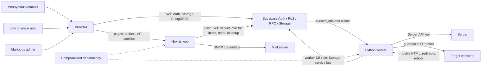

# Application security audit

## Executive summary
1. The principal trust boundary is the browser's Supabase session: Next.js uses it for RLS-backed operations, while the worker has a separate Postgres role and the server holds a service-role key (`apps/web/src/lib/supabase/server.ts:6-26`; `apps/web/src/lib/supabase/admin.ts:1-16`; `apps/worker/src/worker/main.py:45-54`).
2. **BLOCKER:** `users.manage` alone can grant the protected Admin role through the invite action, and a holder can update their own `role_id` directly under RLS; ADR 0012 only identifies `roles.manage` as admin equivalent (S-01).
3. The public password-reset action uses the service-role client to generate links and sends SMTP mail with no application-level per-address or per-IP throttle (S-02).
4. Login, signup, invite, reset confirmation, and set-password have server-side checks; `safeNext` rejects absolute, protocol-relative, backslash, and control-character redirects (`apps/web/src/features/auth/actions.ts:21-151`; `apps/web/src/lib/auth/redirect.ts:6-17`).
5. The worker's website fetcher validates every redirect and pins DNS at socket connection; no reachable SSRF bypass was established by this static review (`apps/worker/src/worker/fetch/fetcher.py:189-210,245-272`; `apps/worker/src/worker/fetch/transport.py:25-54`).
6. Scraped HTML is parsed into text/signals, and React renders result strings as text; the one `dangerouslySetInnerHTML` call contains a fixed theme script (`apps/worker/src/worker/checks/page.py:64-101`; `apps/web/src/features/results/result-detail-drawer.tsx:279-301`; `apps/web/src/app/layout.tsx:29-42`).
7. The CSV bucket is private, write-once for authenticated clients, path constrained, MIME limited to `text/csv`, and signed preview URLs last 60 seconds (`supabase/migrations/20261015025911_m4_csv_storage.sql:22-47`; `apps/web/src/features/csv/queries.ts:75-100`).
8. `next@16.4.2` is locked while its maintainer lists security advisories fixed in 16.4.5; this audit did not establish that a specific vulnerable code path is used here (S-03).
9. Gitleaks found no leak in 15 Git commits or the scoped source/snippet/deploy scans; ignored local `.env` files contain expected JWT-shaped credentials and were not copied into this report (`gitleaks git --redact`; `gitleaks dir --redact`; `git check-ignore -v`; see scan record below).
10. Findings: **1 BLOCKER, 1 HIGH, 3 MEDIUM, 0 LOW**. Existing B-01/B-10, P-04/P-08/P-10, O-08, UX-11, and I-08 cover related formula injection, abuse, tenancy, privacy, scratch SQL, audit gaps, and secret operations.

## Threat model

**Assets:** Supabase Auth accounts and sessions; role assignments and permission catalog; client job settings, CSVs and Storage objects; prospect/review/outreach data; service-role, worker DB, Serper, SMTP and tunnel credentials; paid-search credits; review and job audit records (`supabase/migrations/20261008075408_m1_identity_schema.sql:19-55`; `supabase/migrations/20261015024143_m4_csv_schema.sql:173-190`; `supabase/migrations/20261010181643_m2_jobs_schema.sql:191-205`; `docs/secrets.md:3-36`).

**Trust boundaries:** anonymous browser to Next.js/Auth; authenticated browser to PostgREST/RLS and Storage policies; Next.js server to service-role Supabase and SMTP; worker role to Postgres RPCs; worker's Storage service key; worker to untrusted Serper and websites. `server-only` prevents accidental client imports of the service key, but the authorization check at each service-role call site is still decisive (`apps/web/src/lib/supabase/admin.ts:1-16`; `apps/web/src/features/auth/actions.ts:88-123`; `apps/web/src/features/users/actions.ts:134-185`).

**Attacker types:** an anonymous visitor can submit login/signup/reset and reach public health; a low-privilege authenticated user can call Supabase directly with their JWT, bypassing the UI; a malicious admin can deliberately alter roles, users, jobs and data; a malicious website controls fetched bytes, redirects and HTML; a compromised npm/PyPI dependency executes inside web/worker privileges (`apps/web/src/lib/auth/gate.ts:11-53`; `apps/worker/src/worker/fetch/fetcher.py:189-272`; `apps/web/package.json:17-55`; `apps/worker/pyproject.toml:7-33`).

| STRIDE category | Concrete path and check |
|---|---|
| Spoofing | Supabase `getUser()` verifies sessions in proxy and server session code; active-profile checks also exist in RLS (`apps/web/src/lib/supabase/middleware.ts:29-53`; `apps/web/src/lib/auth/session.ts:25-61`; `supabase/migrations/20261008075422_m1_guards_and_rls.sql:22-37`). Reset links are OTP hashes verified once through Auth (`apps/web/src/app/auth/confirm/route.ts:10-27`). |
| Tampering | Client mutations use permissioned RLS/RPCs, but a `users.manage` holder can alter role assignment to Admin (S-01); reviewer changes append a DB audit row (`supabase/migrations/20261008075422_m1_guards_and_rls.sql:231-234`; `supabase/migrations/20261028010000_m6_review_schema.sql:60-143`). |
| Repudiation | Review history and job events exist, but role/user/blocklist changes lack equivalent durable actor events, and deleting a job cascades its events (`supabase/migrations/20261028010000_m6_review_schema.sql:107-143`; `supabase/migrations/20261010181643_m2_jobs_schema.sql:191-205`; UX-11). |
| Information disclosure | Global `jobs.view` is not tenant scoped (P-08); CSV Storage read needs `csv.upload`, and the preview URL expires after 60 seconds (`supabase/migrations/20261015025911_m4_csv_storage.sql:44-47`; `apps/web/src/features/csv/queries.ts:75-100`). Missing repository-defined browser headers leave edge configuration to verify (S-04). |
| Denial of service | Public reset mail can be invoked repeatedly (S-02); exports and account search spend have separate findings B-10 and P-04. Worker fetches have deadlines/body limits (`apps/worker/src/worker/config/settings.py:34-44`; `apps/worker/src/worker/fetch/fetcher.py:369-398`). |
| Elevation of privilege | `roles.manage` is intentionally admin equivalent (ADR 0012); `users.manage` reaches the same outcome through profile assignment and service-role invitation (S-01; `docs/adr/0012-roles-manage-is-admin-equivalent.md:1-16`). |

## Control verification

| Surface | Code-level result |
|---|---|
| Authentication and links | `proxy.ts` matches routes except static assets/image/health; `updateSession` calls `getUser` and checks profile status, returning 503 on profile DB error (`apps/web/src/proxy.ts:1-7`; `apps/web/src/lib/supabase/middleware.ts:29-60`). `loginAction` signs out inactive users; signup creates pending profiles and drops the new session (`apps/web/src/features/auth/actions.ts:21-85`). Invite uses `generateLink`, activates a profile, then mails a hashed OTP; recovery likewise generates and mails a link (`apps/web/src/features/users/actions.ts:134-213`; `apps/web/src/features/auth/actions.ts:88-123`). `auth/confirm` accepts only invite/recovery types; `safeNext` and its tests cover common open redirects (`apps/web/src/app/auth/confirm/route.ts:10-27`; `apps/web/src/lib/auth/redirect.ts:6-17`; `apps/web/src/lib/auth/redirect.test.ts:9-23`). |
| Authorization and IDOR | The permission helper checks `auth.uid()` against an active profile; `save_role` is invoker security and checks `roles.manage`; RLS covers role/profile writes (`supabase/migrations/20261008075422_m1_guards_and_rls.sql:22-37,180-234`; `supabase/migrations/20261009164159_m1_role_builder_rpc.sql:24-90`). Result export checks three permissions and its SQL RPC checks again; error download verifies upload ID and job ID under RLS (`apps/web/src/app/api/jobs/[id]/results/export/route.ts:13-65`; `supabase/migrations/20261029050000_m6_results_export.sql:24-59`; `apps/web/src/app/api/jobs/[id]/uploads/[uploadId]/errors/route.ts:6-31`). No distinct cross-job IDOR was established within the intended single-team data model; P-08 records the absent tenant boundary. S-01 is a verified role escalation path. |
| Server actions | Auth uses Zod for four actions (`apps/web/src/features/auth/actions.ts:21-26,47-52,88-93,126-131`). Users, roles, jobs, CSV, activities and blocklist actions use Zod schemas or `jobIdSchema` before writes (`apps/web/src/features/users/actions.ts:35-44,134-145`; `apps/web/src/features/roles/actions.ts:36-45,95-104`; `apps/web/src/features/jobs/actions.ts:69-80,158-167,205-214,273-289,308-319,337-349`; `apps/web/src/features/csv/actions.ts:49-59,88-96,186-194,262-270,330-345`; `apps/web/src/features/activities/actions.ts:28-43`; `apps/web/src/features/blocklist/actions.ts:41-52,74-85,102-112`). Review actions use bounded manual validation rather than Zod, including a 50-row batch cap and field type/length checks; the placement RPC validates URL schemes (`apps/web/src/features/results/review-input.ts:21-68`; `apps/web/src/features/results/actions.ts:94-123,151-191`; `supabase/migrations/20261104050000_link_placements.sql:73-95`). Thus the literal claim “all inputs are Zod validated” is false, but no unvalidated write was established. |
| Route handlers | `/api/health` and `/api/system/workers` take no input; workers requires `system.view_health` (`apps/web/src/app/api/health/route.ts:1-3`; `apps/web/src/app/api/system/workers/route.ts:8-25`). Report export parses and rejects invalid filters; result export parses ID/form and checks Origin if present; CSV error download does not Zod-parse path IDs, but sends them through typed equality filters and verifies the upload belongs to the job (`apps/web/src/app/api/reports/export/route.ts:6-38`; `apps/web/src/app/api/jobs/[id]/results/export/route.ts:17-43`; `apps/web/src/app/api/jobs/[id]/uploads/[uploadId]/errors/route.ts:19-31`). Signout restricts GET reasons to an enum and returns a same-origin login redirect (`apps/web/src/app/auth/signout/route.ts:5-25`). |
| SSRF, SQL injection, XSS, CSV | `validate_target_url` allows HTTP(S) ports 80/443, rejects private/link-local/mapped IPv6 addresses, and the transport revalidates/pins the socket destination; redirects re-enter validation (`apps/worker/src/worker/fetch/ssrf.py:11-86,135-183`; `apps/worker/src/worker/fetch/transport.py:25-54`; `apps/worker/src/worker/fetch/fetcher.py:189-210,245-272`). `rg -n -i 'execute\s+(format|v_|\()' supabase/migrations` found no dynamic SQL execution; examined worker queries use parameter binding (`apps/worker/src/worker/stages/opportunity.py:49-83`). Stored prospect URLs come through HTTP(S) normalization (`apps/worker/src/worker/urls/normalize.py:154-175`); React text rendering and `rel="noopener noreferrer"` reduce stored-XSS and tab-nabbing exposure (`apps/web/src/features/results/result-detail-drawer.tsx:279-301,499-515`). CSV error report formula injection remains B-01. |
| Storage | Private bucket, 100 MiB per object, `text/csv` MIME, fixed `<job>/<upload>.csv` insert path and Draft-job check; `csv.upload` permits reads and signed preview URLs expire after 60 seconds (`supabase/migrations/20261015025911_m4_csv_storage.sql:22-47`; `apps/web/src/features/csv/queries.ts:75-100`). MIME is a client claim, not content proof; the worker parses and rejects bad CSV later (`apps/web/src/features/csv/csv-upload-form.tsx:69-79`; `apps/worker/src/worker/io/csv_validator.py:233-265`). No per-user storage quota or orphan sweep was found; cost/retention implications are covered by I-07 and P-10/UX-04. |
| Headers and cookies | Export routes set `nosniff` and `no-store`, but no CSP, HSTS, frame, referrer, or permissions header policy is configured in `apps/web/src`/`next.config.ts`/the draft Compose (`apps/web/src/app/api/jobs/[id]/results/export/route.ts:123-129`; `apps/web/src/app/api/reports/export/route.ts:26-35`; `apps/web/next.config.ts:1-23`; S-04). Supabase SSR sets cookies using SDK-provided options; this audit did not observe production `Secure`, `HttpOnly`, or `SameSite` headers, nor edge CORS/HSTS (`apps/web/src/lib/supabase/middleware.ts:12-25`; `apps/web/src/lib/supabase/server.ts:9-26`). No custom permissive CORS code was found by search. |
| Audit and privacy | Review state changes append rows, while role and blocklist deletion lack an app-level event (UX-11); job events disappear on job deletion (`supabase/migrations/20261028010000_m6_review_schema.sql:107-143`; `supabase/migrations/20261010181643_m2_jobs_schema.sql:191-205`). Stored personal data includes account email/name, local-business phone, CSV `extras`, review notes and optional `contact_email` reviewer fields; the crawler detects contact-link presence rather than extracting email addresses (`supabase/migrations/20261008075408_m1_identity_schema.sql:41-53`; `supabase/migrations/20261015024143_m4_csv_schema.sql:176-190`; `supabase/migrations/20261010183257_m2_seed_activity_profiles.sql:67,106`; `apps/worker/src/worker/stages/opportunity.py:132-141`). Retention, erasure and GDPR/DPDP applicability remain P-10; do not treat job deletion as proven complete erasure. |

## Secret and dependency scan record

`gitleaks git --redact --no-banner` scanned 15 commits and found zero detector matches. Scoped `gitleaks dir --redact` scans of `apps/web/src`, `apps/worker/src`, `supabase/snippets`, and the untracked `deploy` draft found zero matches. The ignored local `apps/web/.env.local` and `apps/worker/.env` produced two and one JWT-rule matches respectively; `git check-ignore -v` confirmed both are ignored by `.gitignore:18-19`, and `git ls-files` returned neither. These are credentials in local configuration, **not evidence of a committed leak**. The tracked snippets contain a named personal email (`supabase/snippets/Untitled query 331.sql:3`; `supabase/snippets/Untitled query 859.sql:3`), already recorded as O-08; this report does not reproduce it.

`pnpm audit --prod --audit-level=low --json` returned `ENOTFOUND registry.npmjs.org`; `UV_CACHE_DIR=/tmp/backlink-uv-cache uv run --frozen --no-sync pip-audit --format json` failed DNS lookup for `pypi.org`. These are **UNVERIFIED** dependency inventories, not clean scans. The committed `pnpm-lock.yaml` pins `next@16.4.2` (`apps/web/pnpm-lock.yaml:2689,6191`), and `uv.lock` is tracked; only one `pnpm-workspace.yaml` exists outside dependencies (`apps/web/pnpm-workspace.yaml:1-3`; `git ls-files apps/web/pnpm-workspace.yaml pnpm-workspace.yaml apps/web/pnpm-lock.yaml apps/worker/uv.lock`). CI runs `pnpm audit --prod --audit-level=high`, `pip-audit`, and Gitleaks, but its current run results are unknown (`.github/workflows/ci.yml:22-24,83-96`).

## Findings

### [S-01] `users.manage` is an undocumented path to full Admin access
- Severity: BLOCKER
- Type: CONFLICT
- Area: Security
- Evidence: `docs/adr/0012-roles-manage-is-admin-equivalent.md:1-16`; `apps/web/src/features/users/actions.ts:134-185`; `apps/web/src/features/users/rules.ts:83-95`; `supabase/migrations/20261008075422_m1_guards_and_rls.sql:107-145,162-165,231-234`; `supabase/tests/database/030_rls_matrix.test.sql:59-62`.
- Why it matters: A user given `users.manage` without `roles.manage` can invite an account they control with the protected Admin role through the UI, then set its password; the role picker and action do not restrict the target role. The same holder can call Supabase directly to update their own profile's `role_id` to Admin because RLS checks only `users.manage`, while the last-Admin trigger blocks demotion rather than promotion.
- Recommendation: Decide explicitly whether `users.manage` is also Admin equivalent. If not, enforce role-assignment ceiling and self-change denial in Postgres, and apply the same ceiling before the service-role invite update; add tests for a custom `users.manage`-only role. Effort M.
- Confidence: High

### [S-02] Public password reset can be used as an email and Auth-cost amplifier
- Severity: HIGH
- Type: GAP
- Area: Security
- Evidence: `apps/web/src/features/auth/actions.ts:88-123`; `apps/web/src/lib/supabase/admin.ts:6-16`; `apps/web/src/lib/mail/send.ts:24-42`; `supabase/config.toml:197-235` (local Auth limits, not an app reset throttle); `apps/web/src/features/auth/forms.tsx:115-131`.
- Why it matters: An anonymous attacker can repeatedly submit the same active email; every accepted call makes a service-role Auth `generateLink` request and sends an SMTP message, while the action has no per-IP or per-account limiter. This can flood a user's inbox and consume provider resources; the generic response hides the account state in text, though timing uniformity was not measured.
- Recommendation: Add a durable per-account and per-IP reset cooldown/volume cap at the action or edge, retain a generic response, and monitor generated-link and SMTP volume. Verify provider-side rate limits separately rather than relying on local `auth.email` settings. Effort M.
- Confidence: High

### [S-03] The locked Next.js version predates published security fixes
- Severity: MEDIUM
- Type: RISK
- Area: Security
- Evidence: `apps/web/package.json:28-31`; `apps/web/pnpm-lock.yaml:2689,6191`; `apps/web/next.config.ts:3-8`; [Vercel advisory GHSA-pc58-hwjq-p385](https://github.com/vercel/next.js/security/advisories/GHSA-pc58-hwjq-p385); [Vercel advisory GHSA-rhh4-g77r-r9qj](https://github.com/vercel/next.js/security/advisories/GHSA-rhh4-g77r-r9qj); [Vercel advisory GHSA-vvgp-ww4w-46vf](https://github.com/vercel/next.js/security/advisories/GHSA-vvgp-ww4w-46vf).
- Why it matters: The maintained package lists `16.4.2` within affected ranges and `16.4.5` as the patched release for several disclosure/cache issues; a future use of the affected fetch or cache pattern could expose another user's response. This audit did not establish a reachable exploit here: no app `use cache` directive was found, and `partialPrefetching: true` removes a stated precondition for GHSA-vvgp-ww4w-46vf.
- Recommendation: Upgrade Next.js and its lockfile to a patched supported release, rerun the full web and browser gates, and restore network access for the complete npm/PyPI advisory audits. Effort S.
- Confidence: High

### [S-04] Browser security headers have no repository-owned policy
- Severity: MEDIUM
- Type: GAP
- Area: Security
- Evidence: `apps/web/next.config.ts:1-23`; `apps/web/src/app/layout.tsx:29-42`; `deploy/production/compose.yaml:3-64`; `apps/web/src/app/api/reports/export/route.ts:26-35`; `rg -n 'Content-Security-Policy|Strict-Transport-Security|X-Frame-Options|Referrer-Policy|Permissions-Policy' apps/web/src apps/web/next.config.ts deploy` returned no matches.
- Why it matters: If the external edge does not set a frame policy, an attacker can frame the app and try to trick a signed-in operator into clicking a sensitive control. Without a CSP, any later HTML injection has fewer browser constraints; the fixed inline theme script requires a nonce/hash or an external script when CSP is added.
- Recommendation: Define CSP (with a safe treatment for the inline theme script), frame-ancestors, HSTS, referrer, and permissions policies in the deployed web/edge configuration; capture a production response to verify them. Effort S.
- Confidence: Medium

### [S-05] Password change relies on possession of any session in local configuration
- Severity: MEDIUM
- Type: RISK
- Area: Security
- Evidence: `apps/web/src/features/auth/actions.ts:126-151`; `apps/web/src/app/set-password/page.tsx:4-14`; `supabase/config.toml:219-235` (`secure_password_change = false`); `apps/web/src/lib/supabase/middleware.ts:29-53`.
- Why it matters: Under the checked local Auth setting, an attacker who steals a valid session can call the set-password action and replace the password without proving recent login or control of a recovery email. The production Auth setting is **UNVERIFIED**, so the same persistent-takeover path cannot be asserted for a hosted project.
- Recommendation: Require recent authentication for ordinary password changes, keep a distinct verified invite/recovery path, enable and test secure password change in each environment, and document the production Auth setting. Effort M.
- Confidence: Medium

## Things I could not verify

- Production Supabase Auth settings, cookie attributes, edge CORS/HSTS/frame policies, actual email provider rate limits, or whether the draft VPS is deployed. Evidence needed: live response headers and hosted project/edge settings, obtained by the owner in a test environment.
- Full npm and PyPI advisory status: the local audit commands could not resolve registry hosts. Evidence needed: successful `pnpm audit --prod --audit-level=low` and `uv run pip-audit` output in a networked, reproducible CI run.
- A live authorization exploit or cross-job data access: no external system was probed and no real user/session was used. The S-01 paths are established by action and RLS code; a disposable local DB test with a `users.manage`-only role would settle runtime behavior.
- Whether scanned local JWT-shaped credentials are still valid; this report did not print, copy, or test them. Gitleaks zero matches do not prove the absence of every secret format.
- Legal jurisdiction and data-subject obligations. P-10 identifies the data categories and policy gap; owner counsel must decide GDPR/DPDP applicability.

## Questions for the owner

1. Is `users.manage` intentionally Admin equivalent, including the power to create another Admin and change one's own role through PostgREST?
2. What are production Supabase Auth settings for secure password changes, OTP expiry, and provider rate limits? Who owns abuse alarms for reset email and Serper?
3. Which component sets security headers and cookie policy in the intended deployment, and can a test response be supplied?
4. Which personal data may be entered into CSV extras, notes and contact fields, and what retention/erasure schedule applies to Storage objects, job history and backups?
